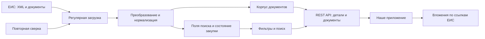

# ГосПлан: устройство сервиса и выводы для нашего проекта

Аудит S132, 2026-10-01. Владелец — основной Codex.
Область: публичная документация, OpenAPI, опубликованные материалы автора,
ограниченные read-only вызовы test API. Исходники backend, приватные DAG,
БД и телеметрия недоступны. «Полный анализ» ниже относится к доступному
контракту и восстановленной логике; конкретные внутренние реализации не выдумываются.

Обозначения: **Факт** — live наблюдение; **Источник** — заявление текущих
документов; **История** — устаревший материал автора в поисковом индексе;
**Вывод** — восстановление по контракту; **UNKNOWN** — не установлено.

## 1. Главное устройство

**Источник:** [главная](https://gosplan.info/) описывает нормализованные и
кешированные данные ЕИС, независимые от её интерфейса.
[Расписание](https://gosplan.info/docs/guides/data-periods/) подтверждает
регулярную загрузку и повторную сверку. Поэтому пользователь обращается к
подготовленному корпусу ГосПлана. Общая архитектура подтверждена документацией;
мы не наблюдали внутренний сетевой trace каждого запроса.

Это логическая схема. Она не утверждает число микросервисов, конкретные БД,
очереди, порядок транзакций или наличие файлового mirror.
Главное ускорение: загрузка вынесена из пользовательского запроса.

## 2. Что известно о стеке

В индексированных старых версиях авторской wiki прямо описаны
Python 3/FastAPI, MongoDB как основное хранилище, S3 как промежуточное
хранилище/обмен/backup и Apache Airflow для фоновых DAG.
[Исторический материал автора](https://wiki.gosplan.info/%2Bshow/%2Bb1f9ad2e2f6f4c7b8743023e8b89c87e/Home),
[другая историческая редакция](https://wiki.gosplan.info/%2Bshow/%2B201f2864587047818e0e13e5af08f172/Home).
Они сейчас перенаправляют на новый сайт; описание доступно в поисковом
индексе, повторное live получение оригинальной редакции не удалось.
**Это историческое заявление, не подтверждение текущего production стека.**

| Компонент | Evidence | Статус сейчас |
|---|---|---|
| HTTP/JSON API | Шесть успешных запросов, OpenAPI 3.1 | Факт |
| Uvicorn | `Server: uvicorn` в шести ответах | Факт заголовка, не проверка внутреннего процесса |
| FastAPI/Python | Старое описание + совместимость с Uvicorn | История; текущий framework UNKNOWN |
| MongoDB | Старое описание автора | История; текущая БД UNKNOWN |
| S3 | Старое описание автора | История; текущие bucket/provider/retention UNKNOWN |
| Airflow | Старое описание автора | История; текущие DAG/оператор/queue UNKNOWN |
| Фоновая синхронизация | Текущее расписание и отдельные DB/source timestamps | Источник и live поля |
| Engine текстового поиска | Есть relevance sort в контракте | Алгоритм/индексы/морфология UNKNOWN |

MongoDB удобна для вложенных разнородных XML-представлений. Airflow удобен
для календарных загрузок и повторов. Это объяснение пригодности технологий,
а не доказательство конкретной реализации. Указание MongoDB не доказывает
Mongo `$text`, а Uvicorn не доказывает число workers или asynchronous DB driver.

Публичный backend репозиторий не найден в проверенных источниках. Ссылка
с сайта на `gitverse.ru/gosplan-v2/Roadmap` при прямой проверке вернула 404;
это не доказательство отсутствия репозитория или всех исходников.
Telegram — публичная группа, не полученный нами журнал внутренней разработки.

## 3. Как пополняется корпус

**Источник:** [руководство истории](https://gosplan.info/docs/guides/history-data/)
пишет о замене FTP на сервисы отдачи информации и документов ЕИС с 2025 года.
**Вывод:** нынешняя загрузка, вероятнее всего, опирается на машинную отдачу ЕИС,
а не на обход каждого HTML результата. Какой именно сервис/учётная запись,
параметры запросов, egress и concurrency применяются — UNKNOWN.
Старое упоминание AS2 в wiki не доказывает транспорт получения данных ГосПланом.

Восстановленные логические этапы:

1. Scheduler выбирает закон/подсистему и период загрузки.
2. Loader получает опубликованные машинные документы.
3. Parser преобразует XML в JSON, выделяет идентификаторы и тип.
4. Нормализатор обновляет поля поиска закупки, контракта или плана.
5. Обновляются список документов и вычисленный этап процедуры.
6. Повторная сверка подхватывает пропущенные/поздние изменения.

Пункты отражают внешние свойства и документацию. Разбиение на регион × тип ×
дата/час, staging ZIP в S3, dedup по ID/version и конкретная схема checkpoint —
правдоподобные способы реализации, но не наблюдаемые факты ГосПлана.

### Регулярность и граница истории

[Текущее расписание](https://gosplan.info/docs/guides/data-periods/):

| Данные | Начало корпуса | Обновление |
|---|---|---|
| Извещения/контракты 44-ФЗ | 01.01.2024 | Ежечасно + ежедневная сверка |
| Извещения/договоры 223-ФЗ | 01.10.2024 | Ежечасно + ежедневная сверка |
| Планы 44-ФЗ | 01.01.2024 | Ежедневно |
| Планы 223-ФЗ | 01.10.2024 | Ежедневно |
| ПП РФ 615 | 01.01.2025 | Ежедневно |
| Организации | 07.08.2026 | По необходимости |
| КТРУ | 25.08.2026 | Еженедельно |
| Жалобы 44-ФЗ | 05.09.2026 | Ежедневно |

Повторная сверка закупок 44-ФЗ — 00:00–03:15 МСК, 223-ФЗ — 05:00–08:15,
за предыдущие сутки. Это повторное получение, а не только обработка ошибок.
Время и периодичность — обещание документации, не измеренные нами DAG runs.
[FAQ](https://gosplan.info/docs/faq/) сообщает о загрузке извещений в течение
двух часов, прочих документов утром следующего дня. Таблица и FAQ несколько
расходятся для планов. «Около трёх лет» хранения не означает все документы
за любые три года: действуют даты начала отдельных семейств.

## 4. Два слоя данных в API

Публичные спецификации:
[44-ФЗ](https://swagger.gosplan.info/fz44/swagger.yaml),
[223-ФЗ](https://swagger.gosplan.info/fz223/swagger.yaml).
Обе получили HTTP 200, версия API `v2.4.0`; сайт указывает service `1.6`,
релиз 05.09.2026. Версия XML из ЕИС — отдельное значение.

### Компактный слой поиска

Списки `/fz44/purchases` и `/fz223/purchases` возвращают нормализованные поля:
номер, предмет, цену/валюту, участников-заказчиков, регион, классификаторы,
сроки, этап, даты и перечень типов документов без полного `source`.
Набор полей различается между законами; его нельзя привести к общей модели
без проверки лотов и источника каждого значения.

### Детальный слой

По номеру возвращаются те же поля и `docs[].source`: структурированный
документ ЕИС в JSON. Это преобразование XML, не HTML карточка и не PDF.
В обоих прочитанных `source` все скалярные значения были строками,
числа/булевы значения тоже. В 44-ФЗ атрибут `@schemeVersion` сохранён как
JSON ключ; единичные и повторяющиеся XML элементы дают object/list.
Конкретная XML parser library UNKNOWN.

Проверенные примеры:

| Номер | Structured docs | Ссылки на вложения | Размер ответа |
|---|---:|---:|---:|
| `0848300054826000154`, 44-ФЗ | 1 | 6 | 22 957 байт |
| `32616426034`, 223-ФЗ | 1 | 4 | 15 448 байт |

Ссылки ведут на `zakupki.gov.ru/44fz/filestore/...` и
`zakupki.gov.ru/223/filestore/...`, а не на скачанные нами файлы ГосПлана.
**Шесть/четыре вложения не были скачаны в этом аудите.** В прочитанном
контракте не найден endpoint OCR/полнотекстового анализа этих бинарных файлов.
Нельзя утверждать, что поставщик никогда не хранит их внутри: это UNKNOWN.

44-пример имеет `versionNumber="1"`, XML `@schemeVersion="16.2"`;
223 — `version="1"`. Сервисный релиз, версия API, версия схемы и версия
извещения различны. `/notification` явно возвращает последнюю версию;
полный архив всех прежних версий через этот метод не обещан.
Список `docs` в одной карточке не доказывает полноту истории версий.

Отдельные методы 44-ФЗ: notification, protocols, clarifications, result,
complaints; связь с plans/procedures/contracts и organisations. Для 223
поверхность меньше: purchases, purchaseplans, contracts, organisations.
`/result` описан как `fcsPlacementResult`: отсутствие этого документа даёт
404 и не доказывает отсутствие итогового современного протокола.

## 5. Как устроен поиск

**Контракт:** размер страницы до 100, offset `skip`; фильтры по периоду,
региону/заказчику, цене, срокам и классификаторам. Текст `object_info`
переключает сортировку на релевантность и игнорирует `sort`.
44-ФЗ включает предмет/место поставки, 223-ФЗ — предмет; это не обещание
поиска по всем вложенным ТЗ. Что значит частичное совпадение, как считаются
weights, stem/синонимы/embedding и tie-breaker — UNKNOWN.

**Вывод:** наличие отдельного компактного слоя позволяет фильтровать
подготовленные поля, а не распаковывать XML и открывать DOCX на каждый запрос.
Подобную схему можно сделать в PostgreSQL; менять нашу БД на MongoDB для
получения этой архитектуры не требуется.

Особенности контракта:

- `published_at` — публикация первого документа; `updated_at` — публикация
  последнего документа закупки. `doc_created_at/doc_updated_at` — даты БД.
  API фильтрует по source `updated_*`; отдельного фильтра DB ingest timestamp
  в purchases не описано. Late arrival с давней source датой может пройти
  мимо узкого polling watermark: нужны overlap и reconcile.
- `published_forpast` имеет default `1m`. В 44-spec описание его приоритета
  противоречит ясной формулировке 223-spec: содержит «игнорируется, если
  не заданы ...». До отдельного теста задавать даты явно, не домысливать логику.
- `skip` не является cursor/snapshot. При изменениях корпуса и сортировке
  по relevance возможны пропуски/повторы; стабильный snapshot не обещан.
- В типовых search responses нет общего знаменателя полноты источника.
  Последняя короткая страница завершает только эту выборку данного API.
- Price поля описаны как number/float. Внутреннюю денежную арифметику
  сервиса это не раскрывает. Наш decoder обязан использовать Decimal.
- Public OpenAPI не везде строго задаёт required поля, содержит старые wiki
  ссылки и подозрительный `/fz44/components/{reg_number}` для жалобы.
  Последний route live не проверен. Нужна tolerant schema parsing с quarantine
  неизвестных полей, не слепая генерация разрешающих доменных объектов.

## 6. Этап процедуры и даты: найденные ограничения

[Текущее руководство](https://gosplan.info/docs/guides/purchases/) прямо
описывает вычисление stage по документам: извещение/продление → подача,
комиссионный протокол → комиссия, итоговый документ → завершение,
отмена → отмена. Это собственная проекция, не официальный статус ЕИС.
Полный порядок разрешения конфликтов/отмены отмены в исходниках UNKNOWN.

**Факт:** запрос `stage=1` + `collecting_finished_before=<UTC now>` вернул
три карточки. Пример `0857500000126000340`: stage 1, значение срока
`2026-10-01T07:00:00`; запрос выполнялся в 08:48 UTC. Это доказывает, что
серверный фильтр stage не исключает результаты before-now. Подлинность
текущего срока каждой процедуры в ЕИС отдельно не проверялась.

При этом JSON даты не имеют зоны. Для 44-примера есть точная пара:

| Поле | В `source` | В нормализованном слое |
|---|---|---|
| Publication | `2026-09-25T17:15:12.400+03:00` | `2026-09-25T14:15:12.400000` |
| Deadline | `2026-10-05T10:00:00+03:00` | `2026-10-05T07:00:00` |

**Вывод для этого экземпляра:** время приведено к UTC, offset удалён.
Автоматически назначить UTC всем законам/полям нельзя: 223-пример уже
в `source` имеет `2026-10-08T08:00:00` без зоны. Для допуска нужен отдельный
официальный timezone contract или независимая проверка; иначе UNKNOWN.
Нормализованные DB timestamps тоже наивные, поэтому точный ingestion lag
по разности строк без подтверждения шкалы времени не считается доказанным.

## 7. Измеренная скорость и поведение

Шесть запросов 01.10, 08:47–08:49 UTC (11:47–11:49 МСК), один test endpoint,
интервал между началами не меньше 15 с. Это одиночные наблюдения, не p95/SLA.

| Вызов | HTTP | Время |
|---|---:|---:|
| Бумага, stage 1, явный период и future deadline, limit 3 | 200 | 11,067 с |
| 44 карточка по номеру | 200 | 0,142 с |
| Последнее извещение того же номера | 200 | 0,258 с |
| Stage 1 + past deadline, limit 3 | 200 | 7,687 с |
| 223 карточка по номеру | 200 | 0,215 с |
| Source обновления за сутки, limit 3 | 200 | 0,188 с |

Седьмой вызов: stage 3, широкий период, `sort=updated_at_desc`, limit 1 —
`httpx.ReadTimeout` при read timeout 30 с. Нет HTTP ответа; wall time не
сохранён. Ошибка могла быть на сервисе, proxy или сети; причина UNKNOWN.
Повтор не выполнялся. Поэтому timeline завершённой закупки не исследован
live; полнота предыдущих версий/протоколов остаётся непроверенной.

Скорость lookup значительно лучше измеренных сложных фильтров. Это совместимо
с адресным индексом и разной стоимостью запросов, но не доказывает конкретный
query plan, cold cache или перегрузку Mongo. В S131 были ответы 0,3–1,9 с и
реальные 429. Ускорение поиска надо мерить на наборе запросов, а не обещать
по самому быстрому ответу.

## 8. API слой и эксплуатация

[Авторизация](https://gosplan.info/docs/getting-started/api-key/): production
key authentication, имя `apikey`; предпочитать header. Документация допускает
query/body передачу, но наш клиент не должен переносить секрет в URL.
Test не требует ключа. 401 — ключ, 403 — доступ/срок, 429 — rate limit.
Billing/продление через Telegram-бота описаны публично; его реализация UNKNOWN.

[Тарифы](https://gosplan.info/pricing/): test до 10/мин/IP, production до
10/с и 12 000/час/ключ; 3000 ₽/месяц, 30 000 ₽/год. Это справочные максимумы,
не гарантированная пропускная способность. 12 000/час ограничивает
длительную нагрузку средним примерно 3,33/с, даже если краткий burst 10/с.
Конкретный token bucket/Redis/reverse proxy UNKNOWN.

[Условия](https://gosplan.info/legal/api-usage/) не гарантируют достоверность,
полноту, актуальность или SLA, требуют проверки в официальных источниках.
Бесплатный test подходит для ограниченного исследования, не для production
нагрузки. Платная подписка не означает разрешения всех сценариев передачи
данных клиентам нашего SaaS: право интеграции сверяется до включения.

## 9. Что остаётся неизвестным

- Текущий стек БД/очередей и внутренние исходники.
- Точные методы СОИ, аккаунт/квоты, число workers и аппаратные ресурсы.
- Реальное число документов, размер хранилища, полное покрытие и пропуски.
- Atomic update карточки/source, dedup, retention всех версий, replay после сбоя.
- Точный text search engine, морфология, relevance formula и snapshot pagination.
- Полный алгоритм stage, приоритет событий при равных датах и cancel reversal.
- Наличие OCR/LLM и mirror бинарных вложений внутри сервиса.
- Измеренные production latency/freshness/availability; тест без ключа их не даёт.

Это границы знания, а не дефекты, приписанные автору.

## 10. Что переносить в наш проект

**Применить архитектурный принцип:** постоянно пополняемый корпус →
компактная поисковая проекция → быстрый lookup → документы по спросу.
Наши PostgreSQL/GIN, официальный importer и document queue уже реализуют
часть этой схемы; переписывать весь стек не нужно.

Следующие решения в рамках S131:

1. Same-day lane отдельно от backfill; repeat daily reconciliation после
   успешного checkpoint, с новым поколением evidence.
2. Typed проекция по закону/номеру/лоту/версии с source/ingest timestamp.
   Raw XML bytes хранить отдельно immutable, JSON не заменяет их provenance.
3. Optional ГосПлан adapter: список без source для discovery; detail по номеру;
   официальный by-number check и точные вложения для shortlist.
4. Общий upstream rate budget, короткие timeouts, circuit breaker и кеш.
   При недоступности источник UNKNOWN, локальный поиск продолжает работать.
5. Прямые фильтры active deadline + cancellations; provider stage — hint,
   не доменный PASS. Decimal decode, timezone validation, unknown schemas quarantine.
6. Полный состав по лотам/позициям; PDF/DOCX/XLSX/ZIP читать нашей очередью,
   затем requirements/КП/экономика. Relevance score API не означает прибыль.
7. Для history/competition читать нужные protocols/contracts, сопоставлять
   условия, не считать `/result` универсальным endpoint для всех итогов.

Airflow или MongoDB имеет смысл выбирать только при измеренной необходимости.
Для текущего объёма мы можем получить тот же принцип existing worker + PG +
object storage, сохранив более строгие доменные gates и evidence.

## 11. Evidence и воспроизведение

`scripts/gosplan-public-audit.py docs|api|timeline` сохраняет raw responses,
время/URL/status/SHA в ignored `data/research/gosplan-2026-10-01/`.
API — последовательный, минимум 15 с между началами одного запуска/каталога;
401/403/429/transport error останавливают дальнейшие вызовы. Нет retries или
изменения IP. State file не является глобальным межпроцессным rate limiter:
запускать один экземпляр; production client этим скриптом не заменяется.

19 основных snapshots документов/спецификаций + 6 успешных API ответов,
всего около 0,74 MiB. Дополнительный timeout записан отдельно как событие,
восстановленное из tool traceback; raw body отсутствует.

| Evidence | SHA-256 |
|---|---|
| OpenAPI 44 | `4ff898f2db19a6e3cf8b1a8b261d99391f2b5662c8896401a8d26c9f3f067fa0` |
| OpenAPI 223 | `fb1de15ba972e053a1b64ca8ae42d172da1aa877a2ddfd999078d30e8e6b806f` |
| Расписание | `091a403942569a19e5bea9790b67b8f1a914a4077b00491978900c2229c471f3` |
| Руководство закупок | `565f938ef2fd0304f7bb7344eb78e179adde2918652a42fb2ba87b6da3ce2d29` |
| 44 карточка | `4e69279555203d2d1e82114df3f3c263306c7a5ef3dfbed3d05e5cf396271a44` |
| Последнее извещение | `7bf7457d632dba677e3086254cbf8c9cae21f689c616cecb4fa4aa17fd926a5c` |
| Stage 1 + before-now | `db3d47f4b4433d0524963760ef128a8fa21a0458766efa789ec905e95b3a7842` |
| 223 карточка | `baa3ee32fdecf0e94dc6ec49faa51530cb6cab37d5f7a54394d92d2d55370fc2` |

Вывод: ГосПлан полезен как подготовленный информационный слой ЕИС.
Он демонстрирует жизнеспособность нашей цели быстрого discovery, но не заменяет
полный проверенный комплект, реальные предложения поставщиков и расчёт прибыли.
